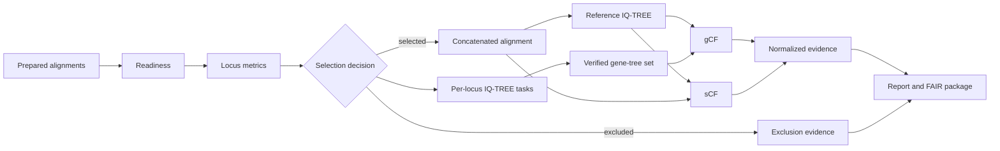

# Executable Alignment-To-Concordance Route

This document defines FAIR PhyloFlow's first authoritative executable route.
It operates on prepared,
curated locus alignments and does not
claim to perform upstream genome retrieval, orthology inference, or biological
species delimitation.

## Route Contract



The route is complete only when every required task has status `verified`.
Process exit code zero is necessary but insufficient: expected artifacts must
exist and pass format and taxon validation.

## Backend Contract

- Authoritative backend for the `0.x` route: IQ-TREE 2.
- Supported version range: `>=2.2.2,<3`.
- Default executable: `iqtree2`, configurable in `project.yaml`.
- IQ-TREE 3 requires a future separately tested compatibility profile.
- Random operations use the configured fixed seed.
- External commands execute as argument arrays without a command shell.

FAIR PhyloFlow does not install scientific tools or launch environment
runtimes. A pinned BioContainer is the strongest reproducibility option; a
pinned Conda/Pixi environment is recommended for local and HPC use; an
expert-provided executable is supported when its version passes validation.
In version 0.1.0, activate or enter that environment first and keep
`execution.mode: local`; the workflow invokes the exposed executable directly.

## Plan And State

`execute --plan-only` writes:

```text
08_runs/<run-id>/run-plan.json
```

The plan includes exact arguments, inputs, checksums, expected outputs,
dependencies, resource settings, seeds, and stable task fingerprints.
Selected loci are copied into `inputs/loci/`; `input-manifest.tsv` maps each
privacy-safe source label to its run-relative immutable staged copy and SHA-256
digest.

Execution writes:

```text
08_runs/<run-id>/run-state.json
08_runs/<run-id>/logs/
08_runs/<run-id>/outputs/
```

`<run-id>` is derived from the resolved configuration, selected input
checksums, execution-contract schema, backend requirement, resources, and
random seed. Identical work maps to the same resumable run; changed evidence or
contract semantics map to a new directory.

Tasks transition through explicit states:

```
planned -> running -> verified
                   -> failed
                   -> invalid_output
         -> blocked
```

An identical resumed plan skips verified tasks whose outputs remain valid.
Before reuse, recorded output checksums are compared with current files. Any
change invalidates the affected task and every downstream dependent task.
Only one process may execute a run ID at a time; `.run.lock` records the active
process and host.
IQ-TREE checkpoint files are retained, allowing IQ-TREE to continue interrupted
work when the command and inputs are unchanged. FAIR PhyloFlow never adds
IQ-TREE's destructive `-redo` option automatically.

## Validation Rules

Reference and locus trees must:

- exist and be nonempty;
- parse as one Newick tree;
- contain unique terminal labels;
- contain at least three labelled taxa;
- contain no taxa absent from their alignment;
- retain every alignment taxon.

Gene trees are combined in manifest order, never filesystem enumeration order.
The combined file and its source manifest are checksummed.

Concordance tasks must produce the IQ-TREE concordance tree, branch-ID tree, and
branch statistics table. gCF, sCF, and traditional branch support remain
separate evidence types in reports. A required normalization task joins gCF and
sCF by IQ-TREE branch ID into `outputs/concordance/branch-summary.tsv`; it never
interprets one measure as the other.

## Failure And Exit Codes

| Code | Meaning |
| ---: | --- |
| 0 | Successful command or plan creation |
| 2 | Configuration, readiness, or input-selection failure |
| 3 | Missing or incompatible IQ-TREE executable |
| 4 | Active run lock, mismatched run state, or incomplete task dependency |
| 5 | External-task or output-validation failure |

No missing tool is downloaded automatically. Planning and non-executing
commands remain available without IQ-TREE.

## FAIR Package

Packaging includes reports, provenance, a portable configuration snapshot, locus
decisions, tree and concordance outputs, structured plan, run state, logs, a
SHA-256 manifest, and RO-Crate-compatible metadata.

Package verification requires the Markdown report, HTML report, provenance,
and portable configuration snapshot; validates every manifest checksum and
byte count; and requires every packaged file to have a matching RO-Crate file
entity. Verification fails for missing, altered, unlisted, duplicated, or
unsafe-path entries.

The live run retains exact execution paths. Its packaged copy replaces the run
root with `${RUN_DIR}` and reduces unrelated absolute paths to basenames to
avoid disclosing workstation directory layouts. Original execution and task
fingerprints remain recorded as provenance identifiers; the packaged plan is an
evidence snapshot, not a directly resumable plan.

The current example alignments are deterministic workflow fixtures. Genuine
biological validation data remain a separate future milestone.
